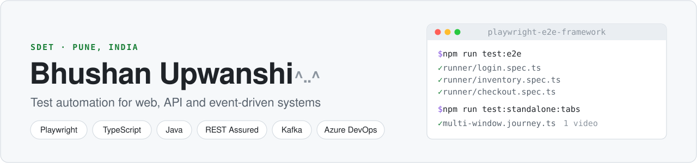
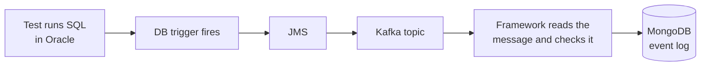

<picture>
  <source media="(prefers-color-scheme: dark)" srcset="assets/banner-dark.svg">
  
</picture>

  
  
  

I'm an SDET at Bajaj Finserv Health in Pune, with 2+ years testing health-insurance web platforms and the microservices behind them. Most of what I build is test automation in Playwright, TypeScript and Java that the team can trust to run on every release.

## At work

- Co-architected the move from Java/Selenium to Playwright + Node.js. Full regression went from **2 hours to 40 minutes**, so it now runs every release instead of every sprint.
- Wrote the framework's helper layer: a click that waits for its API response, condition-based waits, soft assertions, and handlers for feature toggles and files. It removed the old suite's timing-based flaky failures, and other teams now use its DB, API and messaging modules.
- Built API regression of **15,000+ data-driven validations across 5 microservices** in Java, TestNG and REST Assured.
- Built a Kafka testing framework on my own in Jest and Node.js. Adding a new topic only takes a config entry.
- Write Azure DevOps YAML pipelines that run suites in parallel and in shards and publish Allure and CTRF reports. Production monitors for the main user flows raise ELK alerts when they fail.

Here is how a Kafka test runs. The code stays at work, so this is only the pattern:

## Projects

### [playwright-standalone](https://github.com/BhushanUpwanshi/playwright-standalone)

An npm package that runs Playwright suites without a test runner. Playwright records one video per page, so a test that switches tabs leaves you with several files and frozen frames. This package records **one continuous video that follows the active tab** and stops at the step that failed. It also shortens long idle waits in the video, recovers when a page crashes mid-run, and writes Allure and CTRF reports itself.

`npm i playwright-standalone` is the whole setup: no peer dependencies, no system ffmpeg, no separate browser install. 55 unit tests run in GitHub Actions on Node 20, 22 and 24.

### [playwright-e2e-framework](https://github.com/BhushanUpwanshi/playwright-e2e-framework)

A Playwright + TypeScript framework where the page objects don't import anything from a test runner. The same screens, locators and test data drive `@playwright/test` specs and runner-less journeys built on playwright-standalone. A build script fails if anything in `src/` imports the runner, so the separation can't quietly break. Tests run against Sauce Demo and the-internet.

### In progress

**restassured-api-framework**: an API test framework in Java, REST Assured, TestNG and Maven, built against public demo APIs. It goes up here when CI is green.

## Tools

**Languages** 

**UI and API testing** 

**Messaging and data** 

**CI/CD and infrastructure** 

**Reporting and monitoring** 

## Get in touch

Open to SDET and QA automation roles in Pune or remote. The quickest way to reach me is [LinkedIn](https://www.linkedin.com/in/bhushanupwanshi) or [email](mailto:shanupb9@gmail.com).

^..^
